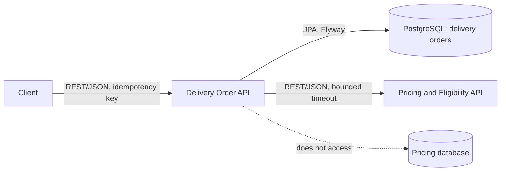

# Architecture

The Pricing API is stateless and owns the pricing/eligibility rules. The Order API validates the order, atomically claims its idempotency key in its own database, then calls pricing without an open database transaction. It persists the final price and outcome on the order record. HTTP business rejections are normal evaluation responses; transport errors and malformed responses result in `PRICING_UNAVAILABLE`. Each application has its own build and Docker image.

## Request outcomes

`POST /api/v1/delivery-orders` returns 201 for the first persisted result and 200 for a replay of the same key and payload. The order status can be `PRICING_PENDING`, `CONFIRMED`, `REJECTED`, or `PRICING_UNAVAILABLE`. A pending duplicate receives the existing pending representation rather than starting a second pricing evaluation. Reusing the key with a different normalized request is 409. Unknown order IDs are 404. Request and constraint failures use RFC 9457 Problem Details.

The Pricing API returns HTTP 200 for both eligible and ineligible evaluations, with `eligible` and an optional rejection code distinguishing the business outcome. Invalid input is 400. This avoids treating routine eligibility decisions as server failures.

## Reliability and scaling

An order row with a unique idempotency key is committed before the pricing HTTP call. PostgreSQL's unique constraint resolves cross-instance races. The losing insert reads and returns the winning row, checking the content fingerprint first. Network calls are outside transactions, with two-second connect and response timeouts and no retry; retrying could amplify a degraded dependency and is unnecessary for deterministic evaluations. An unavailable or malformed response is explicit and never confirms an order. A recovery worker for long-lived pending orders is a production follow-up.

The Order API is stateless aside from PostgreSQL, so multiple instances can share the database. A bounded Hikari pool and short upstream timeout limit resource occupancy. Deployment-specific servlet concurrency, pool sizing, request rate limiting, and back-pressure require load testing at the stated peak. Health, info, and metrics actuator endpoints are exposed. A correlation ID is accepted or generated and propagated to the pricing call.
